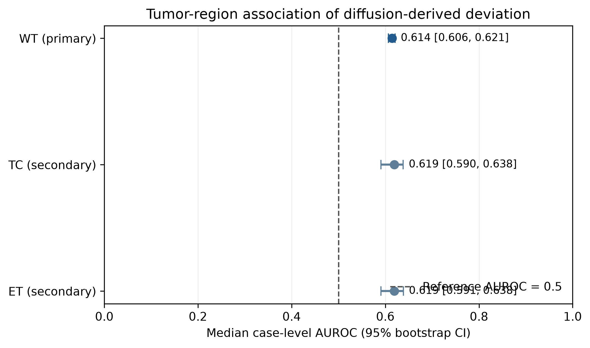
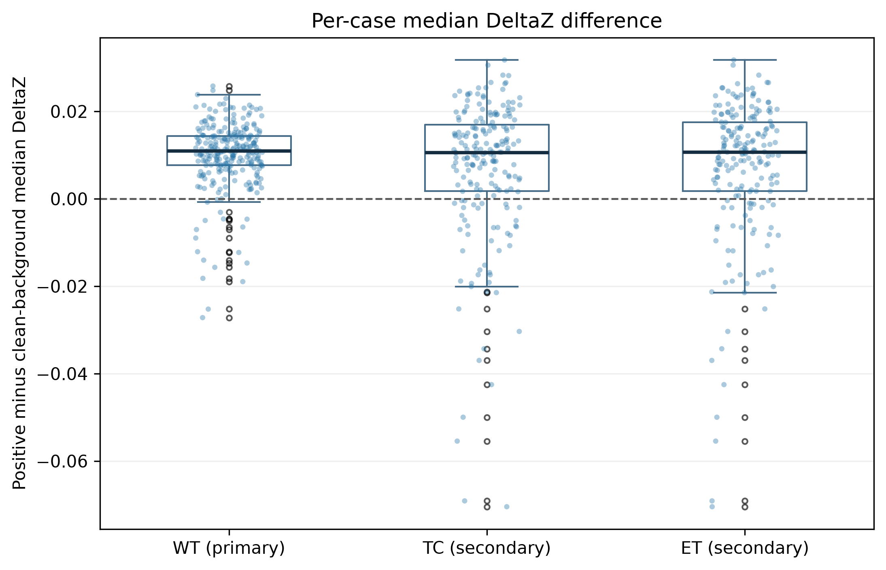
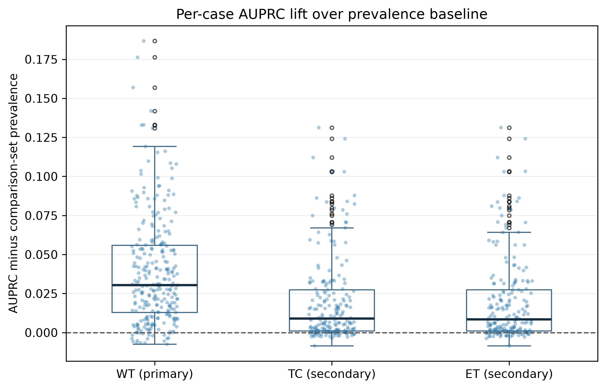
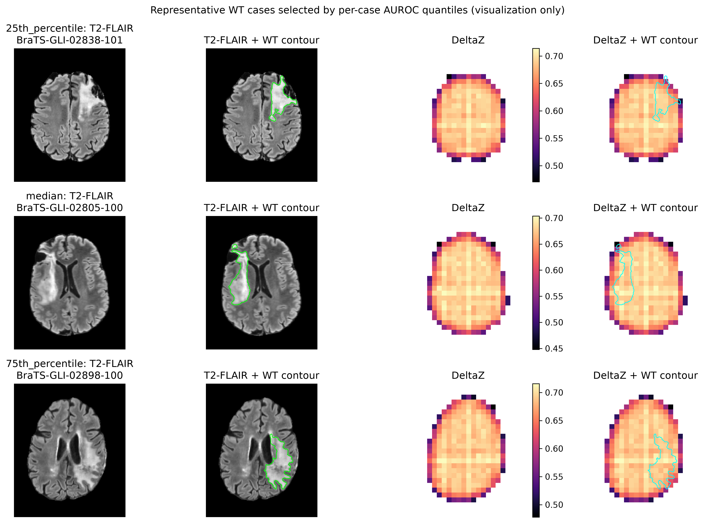

# Brain Tumor Latent Diffusion for Pathology-Associated Deviation Mapping

This repository investigates whether latent diffusion modeling can produce spatially meaningful pathology-associated deviation features from multimodal brain MRI. A frozen encoder supplies an anatomy/background representation, and a deterministic diffusion reconstruction defines a deviation map that is evaluated against tumor labels only after generation. The current evidence supports a modest spatial association on a development-validation cohort; it does not establish diagnostic or clinical performance.

## Research Question

Can diffusion modeling of an anatomy/background representation learned from T1n, T1c, T2w and T2f MRI produce deviation features associated with pathology? The project encodes MRI into a latent representation, applies a frozen latent diffusion prior, and compares the original normalized latent with its prior-guided reconstruction to form DeltaZ, a diffusion-derived deviation map.

Ground-truth (GT) segmentation is not used to generate DeltaZ. It is introduced only in the separate post-hoc pathology-association analysis. A longer-term question is whether DeltaZ contains information complementary to supervised segmentation features.

## Method Overview

```text
T1n + T1c + T2w + T2f
        ↓
Shared 3D Encoder
        ↓
Za: anatomy/background representation
        ↓
Train-derived latent normalization
        ↓
Frozen latent diffusion prior
        ↓
Zprior: prior-guided anatomy/background latent reconstruction
        ↓
DeltaZ = |Za − Zprior|
        ↓
Post-hoc pathology association
```

Earlier E0/E1 work examined segmentation and Za/Zd latent-representation and reconstruction constraints. Those experiments did not provide sufficient evidence for semantic disentanglement or for describing Za as healthy or pathology-free. The broader architecture investigated Za/Zd representations, but successful semantic disentanglement is not claimed here.

## Dataset

The study uses the **BraTS 2024 Adult Glioma Post-Treatment v2** development dataset, with 1,350 available cases. The frozen case split contains 1,080 training cases and 270 validation cases. The latter are referred to throughout as the **development-validation cohort**; they are not an independent held-out external test set.

The four MRI modalities are T1n, T1c, T2w and T2f. BraTS segmentation labels are background (0), NETC (1), SNFH (2), ET (3) and RC (4). The pathology-association analysis uses WT = {1, 2, 3}, TC = {1, 3} and ET = {3}. RC is not silently treated as clean background: only latent cells whose corresponding 8×8×8 block contains label 0 exclusively form the background comparator. Only MRI-supported latent cells enter the comparison.

Raw BraTS data are not included in this repository.

## Experimental Development

E0 established a 3D multimodal segmentation baseline. E1 explored Za/Zd latent representations and reconstruction constraints. These stages did not establish semantic disentanglement or a pathology-free Za representation.

D0 developed a latent diffusion model over the frozen anatomy/background representation. The design uses train-derived per-channel Za normalization, MRI-support masking, EMA diffusion weights, deterministic DDIM inference and spatial whole-volume inference. The primary inference configuration is timestep 495 (alpha-bar 0.5000776052474976), four noise replicates, 50 DDIM model evaluations, eta = 0 and global seed 20260923. Exact dependencies and run identities are recorded in the frozen provenance artifacts rather than repeated here.

## Final Scientific Result

WT was the predeclared primary endpoint; TC and ET were secondary endpoints. Values below are case-level summaries with 95% bootstrap confidence intervals where shown.

| Region | Role | Evaluable | Median AUROC [95% CI] | Median AUPRC [95% CI] | Median AUPRC lift [95% CI] | Median DeltaZ difference [95% CI] | Positive difference |
|---|---|---:|---:|---:|---:|---:|---:|
| WT | **PRIMARY** | 270 / 270 | 0.614130 [0.606392, 0.621043] | 0.128997 [0.109080, 0.143982] | 0.030396 [0.026699, 0.036569] | 0.010929 [0.010256, 0.011505] | 252 / 270 (93.3%) |
| TC | Secondary | 200 / 270 | 0.619183 [0.590473, 0.638138] | 0.033815 [0.025061, 0.047419] | 0.009065 [0.005920, 0.014702] | 0.010578 [0.008668, 0.012173] | 154 / 200 |
| ET | Secondary | 198 / 270 | 0.619359 [0.590944, 0.638412] | 0.033815 [0.024872, 0.047893] | 0.008520 [0.005650, 0.013529] | 0.010651 [0.008728, 0.012242] | 153 / 198 |

For WT, the Holm-adjusted two-sided p-values were 6.062e-41 for AUROC versus 0.5, 2.604e-43 for AUPRC lift versus zero, and 2.261e-35 for median DeltaZ difference versus zero. These are association statistics, not measures of diagnostic performance.

The diffusion-derived deviation maps showed a modest but consistent spatial association with tumor-containing regions on the development-validation cohort. WT provides the most stable primary evidence because all 270 cases were evaluable. TC and ET show a similar directional association with fewer evaluable cases. The observed discrimination is moderate and does not support standalone localization or diagnosis.

## Results and Figures

The canonical reporting package is in [`outputs/reporting/d0c3b_final_v2/`](outputs/reporting/d0c3b_final_v2/). It includes the exact results table, paper-ready summary, provenance and checksums.



Figure 1. Median case-level AUROC and 95% bootstrap intervals, with the 0.5 reference line and WT identified as the primary endpoint.



Figure 2. Per-case median DeltaZ difference between region-positive and clean-background supported cells; points show individual evaluable cases and the dashed line marks zero.



Figure 3. Per-case AUPRC lift above comparison-set prevalence for WT, TC and ET; points show individual evaluable cases and the dashed line marks zero.



Figure 4. Representative cases selected deterministically from the WT AUROC distribution near its 25th percentile, median and 75th percentile, rather than by manual selection of favorable examples. The axial slice is chosen by maximum WT area; DeltaZ is mapped to voxel space by exact block repetition, with unsupported cells masked.

## Reproducibility

The real-data GPU smoke exercised two independent reruns on an NVIDIA GeForce RTX 3090. The tested tensors were exactly equal, with maximum absolute DeltaZ difference 0.0. This was an execution and reproducibility check, not a scientific result.

The primary t=495 generation completed for 270 cases: 36 windows per case and 9,720 windows total. Each case was assembled on a 23 × 28 × 23 global latent grid. The generation was frozen with checksummed provenance. Per-case artifact integrity, exact case-set identity, tensor shapes, support/count consistency and source-model integrity were verified. SHA256 manifests are used for frozen scientific artifacts.

## Interpretation and Limitations

The current evidence supports spatial association between DeltaZ and tumor-containing regions in this development-validation cohort. It does not establish that DeltaZ is a tumor detector, has clinical utility, or improves segmentation. Za is an anatomy/background representation; it has not been established as healthy or pathology-free.

Key limitations are:

- The 270 cases are development-validation data, not an independent external test set.
- Discrimination is moderate, and the analysis tests association rather than diagnostic performance.
- DeltaZ has not yet been fused into the supervised segmentation decoder, so complementary segmentation benefit is unknown.
- Sensitivity timesteps 327 and 663 are deferred experiments.
- No clinical claims are supported by the current analysis.

The primary next step is to evaluate whether DeltaZ provides complementary pathology information when fused with supervised multimodal segmentation features. Further work includes independent evaluation, the predeclared timestep sensitivity analyses and richer anatomy/pathology representation constraints.

## Reproducible Artifacts

Relevant provenance is organized under `outputs/frozen/` and the scientific and reporting outputs. Key records include the D0-A normalization freeze, D0-C2 diffusion training freeze, D0-C3 spatial design freeze, D0-C3 real-data smoke freeze and D0-C3 primary t=495 freeze. The D0-C3b pathology-association outputs and final reporting package preserve the evaluated case-level results and report provenance. Frozen artifact directories include SHA256 manifests for integrity checks.

## Repository Map

- `configs/` — frozen contracts and experiment configuration.
- `datasets/` — data loading, normalization and label handling.
- `models/` — segmentation and latent diffusion models.
- `scripts/` — training, inference, audit and reporting entry points.
- `tests/` — CPU and synthetic regression tests.
- `outputs/frozen/` — compact immutable design and provenance records.
- `outputs/scientific/` — scientific run artifacts and analysis outputs.
- `outputs/reporting/d0c3b_final_v2/` — paper- and presentation-ready figures and summaries.

## Background and Project Status

This work builds on prior research in multimodal brain tumor segmentation and asks whether generative latent modeling can provide pathology-related deviation information complementary to supervised segmentation.

**Research prototype / manuscript in preparation.** If you use or build on this work, please cite the repository until a formal manuscript citation is available.
